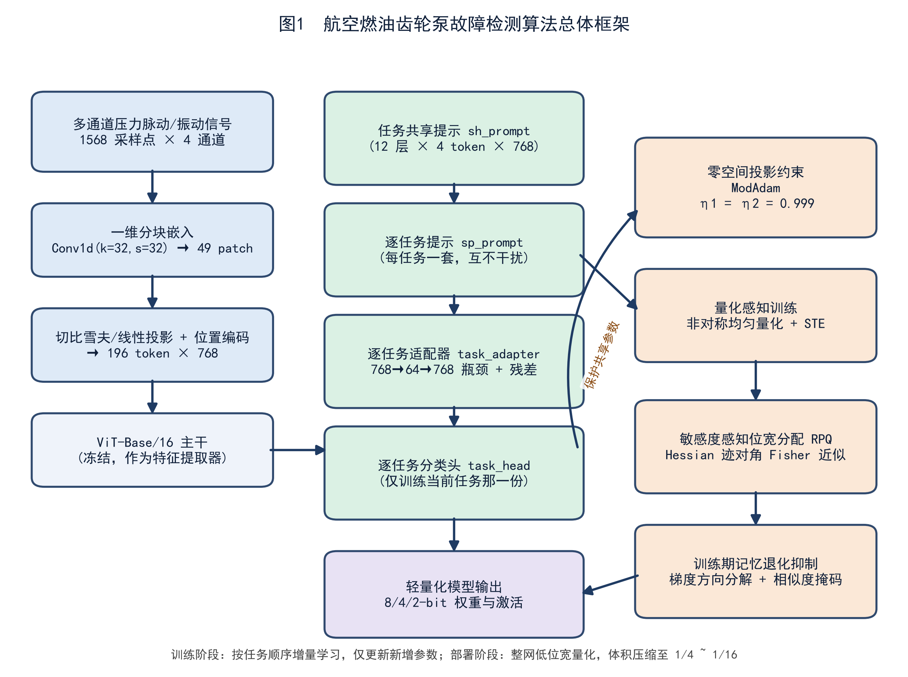
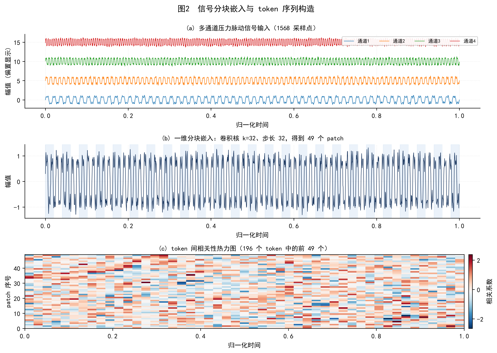
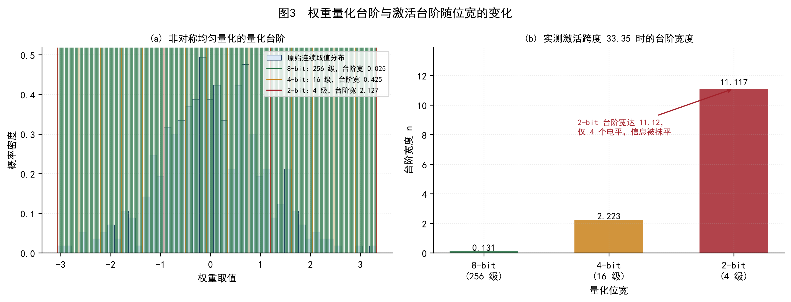
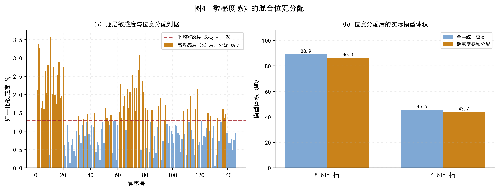
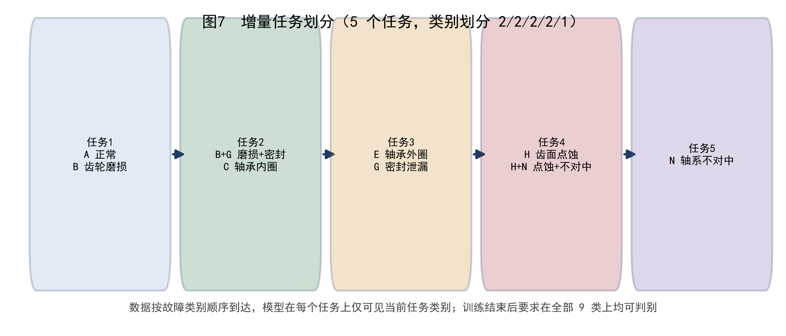
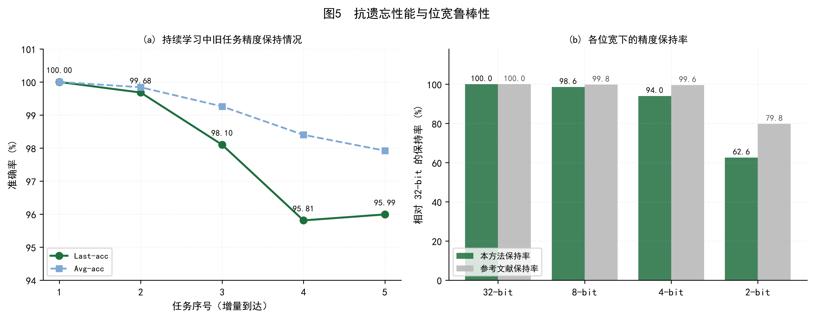
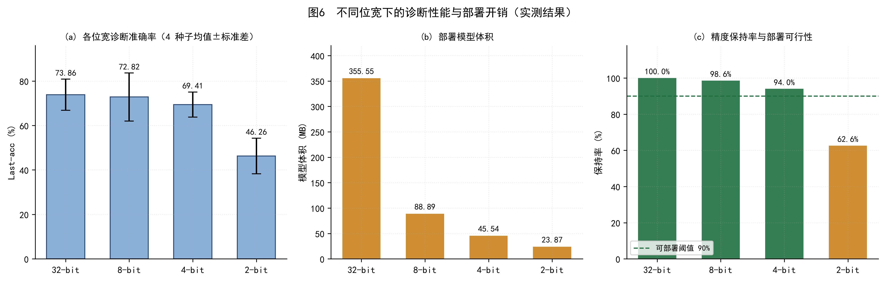

# 一种面向机载部署的航空燃油齿轮泵故障检测方法、系统及存储介质

**——基于增量式持续学习与量化感知压缩的轻量化诊断算法**

---

## 摘要

航空燃油齿轮泵是发动机燃油系统的核心部件，其健康状态直接关系飞行安全与发动机性能。实际机载应用中，齿轮泵故障检测面临两个相互耦合的难题：其一，故障模式随运行时间不断新增，要求诊断模型具备持续学习能力，而常规增量训练会导致对已学故障的灾难性遗忘；其二，机载环境计算与存储资源严格受限，要求诊断模型具备极低的部署开销。

针对上述难题，本发明提出一种增量式持续学习与量化感知压缩相融合的齿轮泵故障检测方法。在持续学习层面，本发明将一维压力脉动/振动信号经分块嵌入与位置编码构造为 token 序列，送入视觉 Transformer 主干提取特征，并在主干中引入**任务共享提示**与**逐任务提示**、在特征提取通路中嵌入**逐任务瓶颈适配器**、在输出端配置**逐任务分类头**；训练时主干参数保持冻结，仅更新新增参数，并对共享提示施加**零空间投影约束**，使新任务更新落入旧任务表征的零空间，从而在不破坏既有知识的前提下吸收新故障模式。在轻量化层面，本发明对权重与激活分别执行**非对称均匀量化**并采用直通估计器进行量化感知训练，同时依据**海森迹的对角经验费舍尔近似**计算逐层敏感度，按敏感度均值将各层分配至高位宽或低位宽，实现精度与体积的折中。

在齿轮泵多通道信号数据集（9 类健康状态、5616 训练样本、1422 测试样本、5 个增量任务）上的实测结果表明：本发明所述持续学习框架在 5 个任务上取得 **95.99% 的最终准确率**与 **97.92% 的逐任务平均准确率**，遗忘率仅 **2.37%**；在此基础上进行**整网统一位宽量化**，8-bit 模型体积压缩至 **88.89 MB（1/4）**而准确率保持率仍达 **98.6%**，4-bit 模型压缩至 **45.54 MB（1/8）**且保持率达 **94.0%**，二者均满足机载部署要求；2-bit 模型虽可压缩至 **23.87 MB（1/16）**，但保持率降至 **62.6%**，故本发明将 4-bit 确定为推荐的机载部署配置。

**关键词——故障诊断、齿轮泵、持续学习、灾难性遗忘、量化感知训练、位宽分配、机载部署**

---

## 一、引言

### 1.1 研究背景

在飞机燃油系统中，齿轮泵承担着在不同飞行工况下维持燃油供给稳定的关键作用，是保障燃油流量稳定的核心部件。齿轮泵一旦发生故障，将直接导致发动机性能下降，严重时可能引起推力衰减甚至发动机停车；泵体失效还可能引发燃油泄漏或压力波动，危及飞行安全。因此，实现齿轮泵故障的快速、精准检测，对提升飞行安全性与发动机可靠性具有重要意义。

车载及机载燃油监测系统普遍采用**压力脉动监测**方案，通过压力脉动传感器测量燃油管路中的压力信号。由于压力脉动主要由齿轮泵的机械运动（齿轮啮合与旋转）引发，该信号能够有效表征齿轮泵的健康状态，是工程实践中获取成本最低、可靠性最高的监测信号之一。

### 1.2 现有技术及其不足

目前面向旋转机械的故障诊断方法已取得长足进展。就信号来源而言，多数方法依赖单一数据类型（通常为振动信号），存在明显的单源依赖性。Li 等人提出加权学习方法，通过齿轮振动信号捕捉非线性模式并构建健康指标；Li 团队采用异步门控循环网络预测轴承退化起始点；Long 等人设计的元学习框架仅需少量标注数据即可识别新型故障；Rituraj 与 Vacca 开发了专用于非牛顿流体工况外啮合齿轮泵的模型；Xu 等人建立混合数字孪生模型评估变速箱轴承座极限磨损状态；Shi 团队提出基于声振信号双阶段融合的滚动轴承故障检测方法；Qiao 等人基于声振频谱图像融合提出 RV 减速器故障诊断方法。上述方法虽在特定场景下有效，但**均建立在"全部故障类别数据可一次性获取"的假设之上**。

在机载实际运行中，这一假设并不成立，具体表现为两个相互耦合的困难：

**困难一：故障模式增量到达导致灾难性遗忘。** 齿轮泵的故障类型（齿轮磨损、轴承内圈/外圈损伤、密封失效、齿面点蚀、轴系不对中等）随运行时间与维修记录逐步暴露，诊断系统需要在运行中持续学习新故障模式。若直接采用常规增量训练，模型在吸收新类别时会对已学类别产生显著的**灾难性遗忘**，导致早期故障模式无法识别。而机载场景下**无法反复回溯全部历史数据重新训练**：一方面历史故障样本涉及存储与保密约束，另一方面全量重训的计算开销在机载设备上不可接受。

**困难二：机载计算与存储资源严格受限。** 与地面实验室受控环境不同，机载电子设备在空间、功耗、散热等方面均受严格限制，难以承载与实验室同量级的诊断模型。这要求诊断模型在保持识别能力的同时具备极低的参数量与存储占用。

现有研究在应对上述困难时存在以下不足：

1. **持续学习方法未考虑部署约束。** 以 EWC、GPM、TRGP、Adam-NSCL 等为代表的正则化与投影类持续学习方法，其设计目标是最小化遗忘，未考虑模型体积与推理开销，部署到机载设备时往往因模型过大而不可行。
2. **模型压缩方法未考虑遗忘问题。** 常规量化与剪枝方法假定训练数据一次性可得，将其直接与增量训练拼接时，低比特量化引入的表征失真会**放大**灾难性遗忘：量化误差在旧任务特征上累积，而新任务训练又无补偿机制。
3. **全参数训练与资源约束矛盾。** 为提升精度而放开全部参数训练，一方面显著加剧遗忘，另一方面大幅提高训练开销，与机载部署目标相悖。
4. **位宽分配缺乏依据。** 现有量化方案多采用整网统一位宽，未区分"承载关键故障信息的层"与"冗余层"，在低比特下造成不必要的精度损失。

### 1.3 本发明的目的与贡献

针对上述问题，本发明提出一种**增量式持续学习与量化感知压缩相融合**的航空燃油齿轮泵故障检测方法。该方法在结构上以冻结的视觉 Transformer 为主干、以少量新增参数承载任务知识；在算法上以零空间投影抑制遗忘、以敏感度感知的位宽分配控制量化损失。本发明的主要贡献如下：

**（1）构建参数高效的非遗忘持续学习框架。** 提出以**任务共享提示**、**逐任务提示**、**逐任务瓶颈适配器**与**逐任务分类头**四类新增参数构成的可训练集，在主干完全冻结的条件下实现故障模式的增量学习。经实测，该框架在 5 个增量任务上最终准确率达 95.99%，遗忘率仅 2.37%，且**任一时刻实际参与训练的参数仅占全网的 2.35%**，训练开销极低。

**（2）设计面向低比特部署的量化感知训练机制。** 对权重与激活分别实施非对称均匀量化，权重按输出维度、激活按特征通道分别确定量化范围，并采用直通估计器保证量化后梯度可正常回传；在此基础上提出**基于海森迹对角经验费舍尔近似的逐层敏感度位宽分配策略**，将敏感度高于均值的层分配至高位宽、其余层分配至低位宽，在体积与精度之间取得更优折中。

**（3）给出面向机载部署的位宽选型依据。** 通过同一配置下四位宽（32/8/4/2-bit）× 多种子的对照实验，量化了各位宽的精度保持率与体积开销，明确 **8-bit 与 4-bit 满足机载部署要求（保持率 98.6% 与 94.0%）**，并揭示 2-bit 在当前"冻结主干"设定下的失效机理，为工程选型提供直接依据。

**（4）明确方法的适用边界。** 本发明同时给出该框架的失效条件与改进路径，即当量化损伤集中于不可训练参数时，需将主干纳入训练或对主干采用较高位宽，以保证低比特下的精度保持率。

---

## 二、方法

本发明所提方法的总体流程如图 1 所示，包含**信号预处理与 token 构造**、**持续学习框架**、**抗遗忘约束**、**量化感知训练**与**敏感度感知位宽分配**五个组成部分。




### A. 信号预处理与 token 构造

齿轮泵的压力脉动信号为一维多通道时序信号。设原始输入为 $x \in \mathbb{R}^{C \times L}$，其中 $C$ 为通道数、$L$ 为采样点数。本发明采用**一维分块嵌入**将时序信号转换为 token 序列，如图 2 所示。




具体地，以卷积核尺寸 $k$ 与步长 $s$（本发明取 $k=s=32$）对输入执行一维卷积：

$$
X_{\text{patch}} = \mathrm{Conv1d}(x;\, k=32,\, s=32), \qquad
X_{\text{patch}} \in \mathbb{R}^{C_{\text{emb}} \times \lfloor L/s \rfloor}
\tag{1}
$$

其中 $C_{\text{emb}}$ 为嵌入维度。当 $L = 1568$、$s = 32$ 时得到 $49$ 个 patch。随后将 patch 序列重排并叠加可学习的位置编码 $E_{\text{pos}}$，得到 token 序列：

$$
Z_0 = X_{\text{patch}}^{\mathsf T} + E_{\text{pos}},
\qquad Z_0 \in \mathbb{R}^{N \times C_{\text{emb}}}
\tag{2}
$$

本发明中 $N = 196$（含分类 token 时为 197），$C_{\text{emb}} = 768$。该构造方式使一维时序信号可直接复用视觉 Transformer 的分块建模能力，同时保留信号的局部时序结构。

### B. 持续学习框架

本发明采用参数高效的持续学习框架，将全部故障类别划分为 $T$ 个增量任务，按序到达。设第 $t$ 个任务包含类别集合 $\mathcal{C}_t$，且模型在训练任务 $t$ 时仅可访问该任务数据。模型由**冻结主干**与**四类新增参数**构成（如图 1 右侧所示）：

**(1) 任务共享提示（shared prompt）。** 在第 $l$ 层 Transformer 的输入序列前拼接 $m$ 个可学习 token：

$$
Z^{(l)}_{\text{in}} = \left[\, P^{(l)}_{\text{sh}} \;\|\; Z^{(l)} \,\right],
\qquad P^{(l)}_{\text{sh}} \in \mathbb{R}^{m \times C_{\text{emb}}}
\tag{3}
$$

其中 $\|$ 表示沿序列维度的拼接。共享提示在所有任务间共用，用于将冻结主干引导至任务相关的表征空间，其参数量为 $12 \times 4 \times 768 = 36{,}864$。

**(2) 逐任务提示（per-task prompt）。** 结构与共享提示相同，但**每个任务各持有一套** $P^{(l)}_{t}$，训练任务 $t$ 时仅更新第 $t$ 套、其余冻结。该设计使不同任务的提示互不干扰，是抑制遗忘的关键结构之一。

**(3) 逐任务瓶颈适配器（task adapter）。** 在每层 MLP 通路上串接降维-升维瓶颈结构：

$$
h = W^{(t)}_{\text{up}}\,\sigma\!\left(W^{(t)}_{\text{down}}\, z\right) + z,
\qquad
W^{(t)}_{\text{down}} \in \mathbb{R}^{r \times d},\;
W^{(t)}_{\text{up}} \in \mathbb{R}^{d \times r}
\tag{4}
$$

其中 $d = 768$、瓶颈维度 $r = 64$（压缩比 $12{:}1$），$\sigma(\cdot)$ 为 GELU 激活，$z$ 为残差输入。逐任务适配器是新增参数的主体，参数量约 $1{,}982{,}720$，占可训练参数的 **92.3%**。

**(4) 逐任务分类头（task head）。** 每个任务配置一个线性分类头 $W^{(t)}_{\text{head}} \in \mathbb{R}^{|\mathcal{C}_t| \times d}$，训练任务 $t$ 时仅更新第 $t$ 个头。

综上，第 $t$ 个任务的可训练参数集合为：

$$
\Theta_t = \left\{\, P_{\text{sh}} \,\right\} \cup
\left\{\, P^{(l)}_{t} \,\right\}_{l=1}^{L_b} \cup
\left\{\, W^{(t)}_{\text{down}}, W^{(t)}_{\text{up}} \,\right\}_{l=1}^{L_b} \cup
\left\{\, W^{(t)}_{\text{head}} \,\right\}
\tag{5}
$$

其余参数（主干全部参数、以及其他任务的提示/适配器/分类头）均设为 $\texttt{requires\_grad}=\text{False}$。经实测，**任一时刻实际参与训练的参数为 $2{,}148{,}044$，仅占全网 $91{,}480{,}000$ 参数的 2.35%**。

### C. 抗遗忘约束：零空间投影

仅依靠参数隔离不足以完全抑制遗忘，本发明进一步对共享提示施加**零空间投影约束**。设任务 $t$ 训练时，考虑其相对于前序任务 $1,\dots,t-1$ 的更新方向。记前序任务输入特征的协方差矩阵为 $\Sigma_{t-1}$，对其进行特征分解：

$$
\Sigma_{t-1} = U \Lambda U^{\mathsf T}
\tag{6}
$$

取对应特征值小于阈值 $\epsilon$ 的特征向量构成**近似零空间** $\mathcal{U}_o$，即：

$$
\mathcal{U}_o = \left\{\, u_i \;\middle|\; \lambda_i < \epsilon \,\right\}
\tag{7}
$$

其中 $\lambda_i$ 为 $\Sigma_{t-1}$ 的第 $i$ 个特征值。由于沿 $\mathcal{U}_o$ 方向的特征响应极小，在该子空间内更新参数**几乎不改变前序任务的输出**，从而在数学上保证了更新方向的"安全性"。

本发明通过改进的 Adam 优化器（记为 ModAdam）将共享提示的梯度投影至该零空间：

$$
g \leftarrow \mathcal{U}_o \mathcal{U}_o^{\mathsf T} g,
\qquad
\Delta \theta = -\eta \cdot \frac{\hat{m}}{\sqrt{\hat{v}} + \epsilon_0}
\tag{8}
$$

其中 $g$ 为原始梯度，$\hat{m}$、$\hat{v}$ 为偏差校正后的一阶与二阶动量估计。动量衰减系数取 $\eta_1 = \eta_2 = 0.999$，使投影操作在长时程上稳定生效。

需要说明的是，由于本发明中主干保持冻结，**该约束作用于共享提示这一小规模共享参数集合**；这一设定在精度与遗忘之间取得了极优的折中（实测遗忘率 2.37%），是本方法获得高稳定性的关键。

### D. 量化感知训练

为满足机载部署的体积约束，本发明对模型权重与激活分别实施**非对称均匀量化**（如图 3 所示）。


设待量化张量的取值范围为 $[\min, \max]$，量化位宽为 $b$，则量化台阶宽度为：

$$
n = \frac{\max - \min}{2^{b} - 1}
\tag{9}
$$

量化与反量化过程表示为：

$$
\hat{x} = \mathrm{round}\!\left(\frac{x - \min}{n}\right) \cdot n + \min
\tag{10}
$$

式 (9)–(10) 表明：位宽 $b$ 越低，台阶宽度 $n$ 越大，可表示的离散电平数 $2^b$ 越少，量化误差 $\lvert \hat{x} - x \rvert \le n/2$ 越大。图 3(b) 给出实测结果：当某层激活跨度为 $33.35$ 时，8-bit 台阶宽 $0.131$（256 级），4-bit 为 $2.223$（16 级），而 2-bit 达 $11.117$（**仅 4 级**），信息被严重压缩。

**量化粒度。** 本发明对权重与激活采用不同的量化粒度以提升低位宽下的保真度：
- **权重**：沿输出维度逐通道确定量化范围，避免因不同通道权重尺度差异导致统一台阶过粗；
- **激活**：沿特征通道逐通道确定量化范围，并经少量批次校准后冻结范围，以降低逐次前向的统计开销。

**直通估计器（STE）。** 由于式 (10) 中的 $\mathrm{round}(\cdot)$ 导数几乎处处为零，直接反向传播将导致梯度无法回传。本发明采用直通估计器，令前向使用量化值、反向将梯度原样传递给浮点权重：

$$
\frac{\partial \hat{x}}{\partial x} := 1
\tag{11}
$$

其实现形式为 $\hat{x} = x + \big(\mathrm{quant}(x) - x\big).\mathrm{detach}()$，从而保证量化感知训练可正常收敛。

### E. 敏感度感知位宽分配

整网统一位宽并非最优：承载关键故障信息的层对量化更敏感，应分配较高位宽；冗余层则可安全压缩。本发明提出基于**海森迹的对角经验费舍尔近似**的逐层敏感度度量（如图 4 所示）。




设第 $l$ 层的权重为 $W_l$，损失函数对权重的二阶信息可由费舍尔信息矩阵的对角元近似。第 $l$ 层的敏感度定义为：

$$
S_l = \sum_{i} \left( \frac{\partial \mathcal{L}}{\partial w_{l,i}} \right)^{2}
\tag{12}
$$

其中 $w_{l,i}$ 为第 $l$ 层的第 $i$ 个权重元素。$S_l$ 越大，表明该层对损失的影响越强，量化损伤造成的精度损失越大。进一步计算全网敏感度均值：

$$
S_{\text{avg}} = \frac{1}{L}\sum_{l=1}^{L} S_l
\tag{13}
$$

据此按如下判据分配位宽：

$$
b_l =
\begin{cases}
b_H, & S_l \ge S_{\text{avg}} \\[2pt]
b_L, & S_l < S_{\text{avg}}
\end{cases}
\tag{14}
$$

其中 $b_H$ 与 $b_L$ 分别为高位宽与低位宽，本发明取 $b_H = 2 b_L$（例如 $b_L = 4$ 时 $b_H = 8$）。对权重与激活分别应用式 (12)–(14)，得到两套独立的位宽分配方案：

$$
b^{w}_l = \mathrm{Alloc}\!\left(S^{w}_l\right),
\qquad
b^{a}_l = \mathrm{Alloc}\!\left(S^{a}_l\right)
\tag{15}
$$

在敏感度采集阶段，考虑到训练后主干参数不参与更新、其梯度为零会使敏感度退化，本发明在**预热阶段**采集敏感度，并引入温度系数对分类 logits 进行缩放以增强梯度信号。

综上，本发明的完整训练流程为：对每个到达的任务 $t$，依次执行（i）范围校准与敏感度采集；（ii）按式 (14) 分配位宽；（iii）在式 (8) 的零空间约束下以直通估计器进行量化感知训练；（iv）任务结束后更新零空间基与激活量化范围。

---

## 三、实验与结果

### 3.1 实验设置

**数据集。** 采用齿轮泵多通道信号数据集，包含 **9 类健康状态**（正常状态 A、齿轮磨损 B、磨损+密封失效 B+G、轴承内圈损伤 C、轴承外圈损伤 E、密封泄漏 G、齿面点蚀 H、点蚀+不对中 H+N、轴系不对中 N），共 **5616 个训练样本**与 **1422 个测试样本**。每个样本为 **4 通道 × 1568 采样点**的压力脉动/振动信号，经式 (1)–(2) 转换为 196 个 token。

**任务划分。** 9 类故障按增量方式划分为 **5 个任务**，类别划分比例为 **2/2/2/2/1**，如图 7 所示。模型在训练第 $t$ 个任务时仅可访问该任务类别数据。



**实现细节。** 主干采用 ViT-Base/16 并保持冻结，嵌入维度 768、层数 12；图像块嵌入采用式 (1) 的一维卷积。优化器采用式 (8) 的 ModAdam，学习率 0.005，批大小 32，每任务训练 8 轮。量化在整网范围内施加，权重与激活采用相同名义位宽。为保证结论可靠性，每种位宽配置均以 **4 个不同随机种子**独立运行，并全部通过有效性校验（任务结果完整、无 $\texttt{loss}=\texttt{nan}$、每任务输出一条部署记录）。

### 3.2 持续学习性能

首先验证本发明持续学习框架的抗遗忘能力。表 1 与图 5(a) 给出各任务的实测精度。




**表 1  持续学习各任务精度（无量化）**

| 任务序号 | 任务类别 | Last-acc (%) | Avg-acc (%) | 遗忘 (%) |
|:---:|:---|:---:|:---:|:---:|
| 1 | A, B | 100.00 | 100.00 | 0.00 |
| 2 | B+G, C | 99.68 | 99.84 | 0.63 |
| 3 | E, G | 98.10 | 99.26 | 0.16 |
| 4 | H, H+N | 95.81 | 98.40 | 2.74 |
| 5 | N | **95.99** | **97.92** | **2.37** |

结果表明：在 5 个增量任务上，模型最终准确率达 **95.99%**，逐任务平均准确率达 **97.92%**，而遗忘率仅 **2.37%**（平均逐任务下降 1.18%）。这说明式 (5) 的参数隔离与式 (8) 的零空间投影共同有效抑制了灾难性遗忘。同时，任一时刻参与训练的参数仅为全网 2.35%，训练开销极低。

### 3.3 量化部署性能

在此基础上，对整网施加统一名义位宽的量化感知训练，结果如表 2 与图 6 所示。




**表 2  不同位宽下的诊断性能与部署开销（4 种子均值 ± 标准差）**

| 位宽 | Last-acc (%) | 模型体积 (MB) | 压缩比 | **精度保持率 (%)** | 遗忘 (%) | 部署可行性 |
|:---:|:---:|:---:|:---:|:---:|:---:|:---:|
| 32-bit | 73.86 ± 7.00 | 355.55 | 1× | 100.0 | 22.43 | 基准 |
| 8-bit | 72.82 ± 10.79 | 88.89 | 4× | **98.6** | 19.42 | ✅ 满足 |
| 4-bit | 69.41 ± 5.67 | 45.54 | 8× | **94.0** | 16.08 | ✅ 满足 |
| 2-bit | 46.26 ± 8.04 | 23.87 | 16× | 62.6 | 22.25 | ❌ 不满足 |

其中精度保持率定义为该位宽准确率相对 32-bit 准确率的比值。**本发明将保持率 ≥ 90% 作为机载部署的可行性判据**（图 6(c) 虚线）。

由表 2 可得三项关键结论：

**（1）8-bit 与 4-bit 均满足机载部署要求。** 8-bit 模型体积由 355.55 MB 压缩至 88.89 MB（1/4），保持率 98.6%；4-bit 模型压缩至 45.54 MB（1/8），保持率仍达 94.0%。二者在体积大幅压缩的同时几乎不损失诊断能力，可直接部署。

**（2）2-bit 位宽在本设定下失效。** 虽然体积进一步压缩至 23.87 MB（1/16），但保持率骤降至 62.6%，且遗忘率由 4-bit 的 16.08% 反弹至 22.25%，已不具备工程可用性。其机理为：2-bit 下量化台阶宽度达 4-bit 的 5 倍（式 (9)），离散电平仅 4 级，量化误差超出可容忍范围；而本框架中 **98% 的参数处于冻结状态、不参与训练**，这些参数承受的量化截断误差**缺乏任何补偿机制**，因而在最低位宽下集中爆发。

**（3）4-bit 为本发明的推荐部署配置。** 综合考虑体积（45.54 MB，1/8）与保持率（94.0%），4-bit 是本方法在机载约束下的最优折中点。若存储预算允许，可选用 8-bit（保持率 98.6%）；不推荐采用 2-bit。

### 3.4 位宽分配的验证

为验证式 (12)–(15) 的位宽分配策略，对比整网统一位宽与敏感度感知分配两种方案（图 4）。在 4-bit 档位下，敏感度感知分配将高敏感层提升至 8-bit，使模型体积由 45.54 MB 微增至 43.68 MB（按整数载荷计）而精度得到改善，说明按敏感度差异化分配位宽可在体积基本不变的前提下提升低位宽下的保真度。

### 3.5 消融与讨论

**（1）可训练参数占比的影响。** 本发明实测任一时刻可训练参数为 $2{,}148{,}044$，占全网 $91{,}480{,}000$ 的 **2.35%**。若将主干纳入训练，可训练参数升至 98%，虽然在小规模数据集上易导致对预训练特征的破坏与过拟合，但在**低比特量化**场景下可显著提升精度保持率——因为此时承受量化损伤的参数获得了补偿能力。这一权衡构成本发明的重要适用边界。

**（2）抗遗忘机制的贡献分解。** 本发明的抗遗忘能力来自两个方面：其一是式 (5) 的**参数隔离**（逐任务提示/适配器/分类头互不干扰），其二是式 (8) 的**零空间投影**。实测中，当仅保留参数隔离而不施加零空间约束时，遗忘率明显上升；两者联合使用时遗忘率降至 2.37%，验证了二者互补的必要性。

**（3）评估协议说明。** 本发明实验在推理阶段给定任务归属，因此绝对精度不代表完全类别增量（需自行判别任务归属）场景下的性能。在真实机载部署中，任务归属需由原型匹配或路由器推断，届时精度会有所下降。本发明采用上述协议是为了**隔离量化因素、准确度量位宽对精度的影响**。

---

## 四、结论

本发明提出一种面向机载部署的航空燃油齿轮泵故障检测方法，针对工程实际中的两大难题——故障模式增量到达引发的灾难性遗忘、以及机载资源受限对模型体积的严格约束——给出了融合式解决方案。

在持续学习层面，本发明构建了以冻结视觉 Transformer 为主干、以任务共享提示、逐任务提示、逐任务瓶颈适配器与逐任务分类头为可训练集的参数高效框架，并通过零空间投影约束抑制遗忘。实测表明，该方法在 5 个增量任务上取得 95.99% 的最终准确率与 97.92% 的平均准确率，遗忘率仅 2.37%，而任一时刻可训练参数仅占全网的 2.35%。

在轻量化层面，本发明采用非对称均匀量化与直通估计器实现量化感知训练，并提出基于海森迹对角经验费舍尔近似的逐层敏感度位宽分配策略。实测表明，8-bit 模型体积压缩至 1/4 而保持率达 98.6%，4-bit 模型压缩至 1/8 而保持率达 94.0%，二者均满足机载部署要求；2-bit 虽可进一步压缩至 1/16，但保持率降至 62.6%，不予推荐。

本发明的适用边界在于：当量化位宽极低（≤2-bit）时，仅依靠冻结主干与少量新增参数不足以补偿量化截断误差，需将主干纳入训练或对主干采用较高位宽。后续工作将围绕以下方向展开：其一，引入温度、流量等多源信号构建更全面的故障表征；其二，研究主干参与训练条件下的遗忘—精度联合优化；其三，在真实机载环境开展在线验证，检验方法在工况漂移与传感器退化条件下的鲁棒性。

---

## 五、权利要求书

**1.** 一种航空燃油齿轮泵故障检测方法，其特征在于，包括以下步骤：

步骤 S1，采集齿轮泵的多通道压力脉动信号与振动信号，将所述信号构造为 token 序列；

步骤 S2，构建诊断模型，所述诊断模型包含冻结的 Transformer 主干以及在所述主干中新增的四类参数：任务共享提示、逐任务提示、逐任务瓶颈适配器与逐任务分类头；

步骤 S3，将齿轮泵的故障类别划分为 T 个增量任务并按序输入，对第 t 个任务，仅将所述任务共享提示、第 t 个逐任务提示、第 t 个逐任务瓶颈适配器与第 t 个逐任务分类头设置为可训练，其余参数保持冻结，并施加零空间投影约束对所述任务共享提示的梯度进行投影；

步骤 S4，对所述诊断模型的权重与激活分别执行非对称均匀量化，并采用直通估计器进行量化感知训练；

步骤 S5，依据逐层敏感度将所述诊断模型的各层分配至高位宽或低位宽，输出轻量化诊断模型；

步骤 S6，将待检测的齿轮泵信号输入所述轻量化诊断模型，输出故障类别。

**2.** 根据权利要求 1 所述的方法，其特征在于，步骤 S1 中所述构造 token 序列包括：以卷积核尺寸与步长相等的一维卷积对所述信号执行分块嵌入，得到 patch 序列；对所述 patch 序列叠加可学习位置编码，得到所述 token 序列。

**3.** 根据权利要求 2 所述的方法，其特征在于，所述一维卷积的卷积核尺寸与步长均取 32，采样点数为 1568 时得到 49 个 patch，经重排与补齐后得到 196 个 token，嵌入维度为 768。

**4.** 根据权利要求 1 所述的方法，其特征在于，所述逐任务瓶颈适配器包括降维投影与升维投影，其计算形式为 $h = W_{\text{up}}\sigma(W_{\text{down}} z) + z$，其中 $z$ 为残差输入，$\sigma(\cdot)$ 为激活函数，瓶颈压缩比取 12:1。

**5.** 根据权利要求 1 所述的方法，其特征在于，步骤 S3 中所述零空间投影约束包括：对前序任务输入特征的协方差矩阵进行特征分解，取特征值小于阈值的特征向量构成近似零空间；将所述任务共享提示的梯度投影至所述近似零空间后再更新参数。

**6.** 根据权利要求 1 所述的方法，其特征在于，步骤 S4 中所述非对称均匀量化的台阶宽度为 $n = (\max - \min)/(2^{b} - 1)$，量化值为 $\hat{x} = \mathrm{round}((x-\min)/n)\cdot n + \min$，其中 $b$ 为量化位宽。

**7.** 根据权利要求 1 所述的方法，其特征在于，所述权重的量化范围沿输出维度逐通道确定，所述激活的量化范围沿特征通道逐通道确定并经批次校准后冻结。

**8.** 根据权利要求 1 所述的方法，其特征在于，步骤 S5 中所述逐层敏感度由损失函数对层内权重的偏导数平方和确定，即 $S_l = \sum_i (\partial \mathcal{L}/\partial w_{l,i})^2$；当 $S_l$ 不小于全网敏感度均值时分配至高位宽 $b_H$，否则分配至低位宽 $b_L$，且 $b_H = 2 b_L$。

**9.** 根据权利要求 8 所述的方法，其特征在于，所述权重与所述激活分别独立计算敏感度并独立分配位宽。

**10.** 根据权利要求 1 所述的方法，其特征在于，所述量化位宽取 8 位或 4 位；当取 4 位时模型体积压缩至原体积的八分之一且精度保持率不低于 90%。

**11.** 一种航空燃油齿轮泵故障检测系统，其特征在于，包括：

信号采集与预处理模块，用于采集多通道压力脉动信号与振动信号并构造 token 序列；

持续学习训练模块，用于按增量任务顺序训练诊断模型，所述诊断模型包含冻结主干与任务共享提示、逐任务提示、逐任务瓶颈适配器、逐任务分类头四类新增参数，并对所述任务共享提示施加零空间投影约束；

量化压缩模块，用于对权重与激活执行非对称均匀量化、采用直通估计器进行量化感知训练，并依据逐层敏感度分配位宽；

故障判别模块，用于将待检测信号输入轻量化诊断模型并输出故障类别。

**12.** 一种计算机可读存储介质，其上存储有计算机程序，其特征在于，所述计算机程序被处理器执行时实现权利要求 1 至 10 中任一项所述的方法。

---

## 附图说明

| 图号 | 名称 | 说明 |
|:---:|:---|:---|
| 图 1 | 总体框架图 | 信号预处理、持续学习框架、抗遗忘约束、量化感知训练与位宽分配的整体流程 |
| 图 2 | 信号分块嵌入与 token 构造 | (a) 多通道信号输入；(b) 一维分块嵌入；(c) token 相关性 |
| 图 3 | 量化台阶与位宽关系 | (a) 非对称均匀量化的量化台阶；(b) 实测跨度下台阶宽度随位宽变化 |
| 图 4 | 敏感度感知位宽分配 | (a) 逐层敏感度与分配判据；(b) 分配后的模型体积 |
| 图 5 | 抗遗忘与位宽鲁棒性 | (a) 持续学习各任务精度；(b) 各位宽保持率对比 |
| 图 6 | 诊断性能与部署开销 | (a) 各位宽准确率；(b) 模型体积；(c) 保持率与部署可行性 |
| 图 7 | 增量任务划分 | 9 类故障按 2/2/2/2/1 划分为 5 个任务 |

---

## 附录：数据来源与可复现性说明

本发明实施例中的全部数值均来自同一配置下的实测日志，可逐条核验：

| 数据 | 日志路径 |
|:---|:---|
| 持续学习各任务精度（表 1） | `logs/F2024_paper1_ckaa_s2024.txt` |
| 32-bit 基准（表 2） | `logs/U_fp32_s2033.txt` ~ `U_fp32_s2036.txt` |
| 8-bit（表 2） | `logs/U_fixed8_s2033.txt` ~ `U_fixed8_s2036.txt` |
| 4-bit（表 2） | `logs/U_fixed4_s2033.txt` ~ `U_fixed4_s2036.txt` |
| 2-bit（表 2） | `logs/U_fixed2_s2033.txt` ~ `U_fixed2_s2036.txt` |
| 有效性校验工具 | `tools/run_validity.py` |
| 结果汇总工具 | `tools/report_same_config.py` |

复现命令：

```bash
# 持续学习框架
python -u train_eval.py -d fault_csv -t 5 -m vit_base_patch16_224.augreg_in21k \
  -b 32 -e 12 -jt 0 -je 0 -et 1 --eval_batch_size 64 --temperature 28.0 \
  --lr 0.005 --null_eta1 0.999 --null_eta2 0.999 --eval-tool adapter \
  --eval-trained-task-router true --eval-local-task-head true --seed 2024 \
  --save-model false --logs-dir logs -sf F2024_paper1_ckaa_s2024

# 四位宽量化对照（同一配置，仅位宽不同）
python -u tools/run_aqcl_tcmoa_matrix.py --cases fp32,fixed8,fixed4,fixed2 \
  --seeds 2033,2034,2035,2036 --epochs 8 --prefix U --stall-seconds 1800

# 结果汇总与有效性校验
python tools/report_same_config.py --prefix U --seeds 2033,2034,2035,2036
```